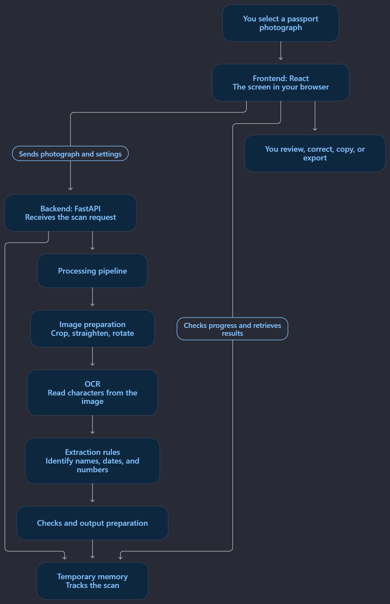

# DocuLens architecture

DocuLens is a local app that reads text from passport and identity-document images. A person selects an image, the app reads and organizes the visible text, and the person reviews the suggested values. It does not verify identity or prove that a document is genuine.

## How a scan moves through the app

<p align="center"></p>

The browser sends the image and scan settings to the Python app. The app prepares the image, reads its text with local OCR models, matches that text to supported fields, and sends the results back to the browser for review. Scan data is kept temporarily in memory; there is no application database.

## One scan, step by step

1. **Choose the document.** The browser accepts a front image and, optionally, a back image. Supported image formats are JPEG, PNG, and WebP. The backend can also read a single-page PDF for each side.
2. **Start a scan session.** The browser checks that the backend is ready, creates or reuses a short-lived session, and sends the image plus options such as language, date order, rotation, and crop corners.
3. **Check and queue the upload.** FastAPI checks the file type and limits, confirms the scan options, and creates a temporary job. It returns a scan ID so the browser can ask for progress.
4. **Prepare the image.** The backend decodes the image, applies its EXIF orientation, and reduces large images for processing. It looks for document edges and, when it can do so safely, crops and straightens the page. A person can adjust all four corners if automatic detection is uncertain.
5. **Check image quality.** The app checks sharpness, lighting, contrast, and other image properties. It warns about possible blur or poor lighting. Selected unclear text areas can receive limited rereads with enlargement, contrast adjustment, or light sharpening. Heavy blur can still make characters unreadable.
6. **Read the text.** Local OCR models detect text lines, check orientation, and recognize characters. Each reading keeps its position and confidence. The app can reread a small number of uncertain regions; these rereads are not independent proof that a value is correct.
7. **Match text to fields.** Extraction rules use nearby labels, page layout, document type, supported aliases, and MRZ structure to identify possible names, dates, numbers, and other values. MRZ checks can catch some reading mistakes, but do not verify authenticity.
8. **Keep uncertainty visible.** The app retains the original OCR evidence and shows missing, uncertain, or conflicting readings as such. It does not fill in unreadable characters just to create a complete value.
9. **Return the results.** The browser checks the scan status about every 250 milliseconds. When processing finishes, the backend returns the fields, warnings, timings, OCR evidence, and original/corrected previews.
10. **Review and clean up.** The person checks the results against the document, then copies or exports them. The browser requests deletion when the scan is cleared or cancelled. As a fallback, completed scans expire from backend memory after the configured retention period.

The progress labels represent actual processing stages: `queued`, `detecting_document`, `correcting_alignment`, `reading_text`, `validating_fields`, and `preparing_results`. Cancellation discards obsolete results. A native OCR call already in progress cannot be forcibly stopped.


## What the main parts do

| Part | What it does | Main code |
| --- | --- | --- |
| Browser interface | Lets a person upload images, adjust the crop, follow progress, review results, and copy or export values. | `frontend/src/` — React and TypeScript |
| HTTP API | Checks requests, manages scan sessions and jobs, and returns progress, results, and image previews. | `backend/app/main.py` — FastAPI |
| Image preparation | Opens images or PDF pages, corrects orientation, finds document edges, straightens the image, and checks its quality. | `backend/app/services/imaging.py` |
| OCR | Uses local models to find lines of text, read characters, and keep confidence and position information. | `backend/app/services/ocr.py` |
| Field extraction | Connects text to labels such as name or date, reads machine-readable-zone (MRZ) lines, and checks supported formats. | `backend/app/extractors/` and `backend/app/patterns/` |
| Result preparation | Formats values and returns supporting text, uncertainty, warnings, timing, and preview information. | `backend/app/services/output.py` and `pipeline.py` |
| OCR model files | Provide the trained text detection and recognition models used by the Python app. | Local RapidOCR / ONNX Runtime model files |

These parts run as one FastAPI application. The boxes in the diagram are steps and modules in that application, not separate servers. OCR runs on the computer hosting DocuLens; uploaded document text is not sent to a remote AI API.

## Main files and folders

```text
doculens/
  ARCHITECTURE.md                  This overview
  README.md                        Install and use the app
  start.ps1                        Start the installed Windows app
  backend/
    app/main.py                    API routes and application startup
    app/core/                      Settings, sessions, limits, and RAM storage
    app/schemas/                   Request and result structures
    app/services/pipeline.py       Runs the scan stages in order
    app/services/imaging.py        Image/PDF decoding, cropping, and quality checks
    app/services/ocr.py            Local model loading and text recognition
    app/services/output.py         Result formatting and checks
    app/extractors/                Labels, layout, MRZ, and field matching
    app/patterns/                  Date, country, and document-number rules
    tests/                         Backend checks
  frontend/
    src/App.tsx                    Connects the main screen
    src/components/                Upload, crop, progress, preview, and results UI
    src/hooks/                     Scan lifecycle and cleanup
    src/services/api.ts            Browser-to-backend requests
    src/types/scan.ts              Frontend result types
    src/test/                      Frontend checks
    dist/                          Built website served by FastAPI
  models/                          Optional local OCR models and sample fixtures
  scripts/                         Evaluation, model, benchmark, and packaging tools
  docs/                            Detailed technical notes and saved reports
```

The `.venv` and `frontend/node_modules` folders hold installed dependencies. `frontend/dist` is the built website. The backend source, model files, local settings, and cached files have different roles; the app needs the source, settings, and required models to run.

## Speed and memory use

The latest saved benchmark in this project was recorded on **26 October 2026**. It used a generated 1400 × 940 pixel JPEG, a Windows 11 computer with a 12-logical-CPU Intel processor and 15.7 GB of RAM, local CPU OCR, and ten scans run one after another after model startup.

| Measurement | Recorded result | What it means |
| --- | ---: | --- |
| Typical scan time (p50) | 1.78 seconds | Half of the ten measured scans finished within this time. |
| Slower scan time (p95) | 2.06 seconds | Nine of ten scans finished within this time. With only ten runs, this is a rough sample, not a guarantee. |
| Average scan time | 1.82 seconds | Average across the ten measured scans. |
| OCR model startup check | 3.76 seconds | Time to load and check the models; Python import time was not included. |
| Backend process memory | 165.84 MB | Resident-memory snapshot at the end of the benchmark, not the peak. |

These figures describe that test image, computer, and software setup. A two-sided scan, larger or harder-to-read image, different OCR model, or slower computer can take longer. The 165.84 MB figure is for the backend process only; it does not include the browser, other computer processes, or peak temporary memory. The benchmark file is [`docs/benchmark.json`](docs/benchmark.json).

The default backend uses one scan worker, and OCR model calls are serialized. If several people submit scans at the same time, later scans can wait in the queue. Raising the worker count does not make the OCR model itself run multiple scans at once.

## Upload and temporary storage limits

| Limit | Default |
| --- | ---: |
| Maximum size per uploaded side | 12 MB |
| Maximum original image dimensions | 40 megapixels and 12,000 pixels on the longest edge |
| Maximum working image | 16 megapixels and 6,000 pixels on the longest edge |
| Active scans held by one backend process | 8 |
| Scans held for one browser session | 1; a new scan clears that session's previous scan |
| Encoded preview-image storage | 160 MB across active scans |
| Completed scan retention | 60 seconds by default; configurable from 30 seconds to one hour |
| Incomplete scan retention | Up to 5 minutes |

Uploads, results, and preview images are held in backend memory while needed. They are removed on deletion, expiry, or application shutdown. The 160 MB preview limit does not include the OCR models, decoded images, temporary processing buffers, or browser memory. The app does not use a database or external job queue.

## API routes

All routes are under `/api/v1`.

| Route | Purpose |
| --- | --- |
| `GET /health` | Reports readiness, available OCR routes, and limits. |
| `POST /session` | Creates or reuses a signed browser session. |
| `POST /scans` | Uploads front/back files and starts a scan. |
| `GET /scans/{id}` | Returns progress, result, or a safe error for that session's scan. |
| `GET /scans/{id}/image` | Returns that scan's original or corrected preview. |
| `DELETE /scans/{id}` | Cancels or deletes that session's scan. |
| `POST /extract` | Runs a one-file extraction through the same pipeline and cleans it up automatically. |

The session cookie restricts access to a scan; it is not an organization login system. The app is designed to run as a single backend process because session and job data live in that process's memory.

## Development and installed use

In the installed app, `start.ps1` launches FastAPI on port 8000. FastAPI serves the built website from `frontend/dist` and handles API requests on the same address.

For frontend development, keep the backend running on port 8000 and run Vite in a second terminal from `frontend` with `npm run dev`. Open `http://127.0.0.1:5173`. Vite forwards API requests to port 8000. Use `127.0.0.1` for both addresses during a session.

This setup is intended for local use. A public multi-user deployment needs additional authentication, HTTPS, and operational controls; the signed local session by itself is not sufficient for that purpose.
