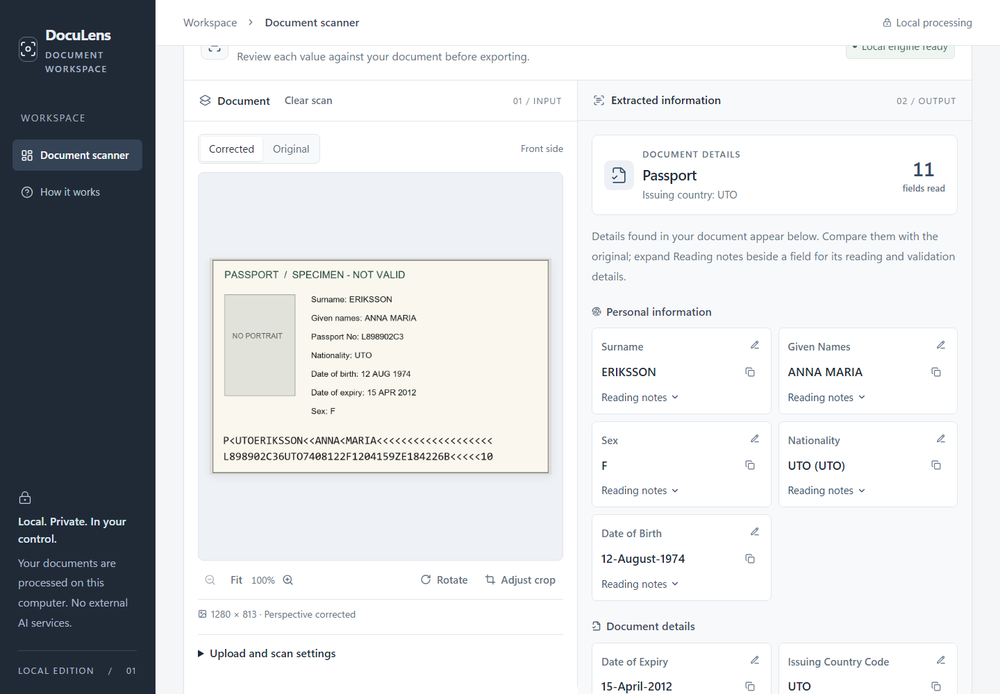

# DocuLens

**Read passports and ID cards from a photo or PDF — locally, privately, with evidence for every value.**

DocuLens straightens a document image, reads its printed text with on-device OCR models, matches
each value to its field (name, dates, nationality, document number, …), checks the machine-readable
zone (MRZ), and shows where every value came from so a person can review it.



<sub>The passport shown is the fictional ICAO specimen used for testing.</sub>

## Try it in one minute

You only need [Docker Desktop](https://www.docker.com/products/docker-desktop/). The published image
contains everything: the website, the API, all models and Tesseract.

```bash
docker run -p 8000:8000 varshith6166/doculens:latest
```

Then open **http://localhost:8000**, upload a passport or ID image (JPG, PNG, WebP or a single-page PDF)
and click **Scan document**. Press `Ctrl+C` in the terminal to stop.

- The first run downloads about 2.7 GB; later starts take about 20 seconds.
- The app needs about 2–3 GB of free memory.
- If port 8000 is busy, use another, for example `-p 8080:8000` and open http://localhost:8080.

## What it does

- **Reads any passport or ID card layout** — captions above, beside or below values; side-by-side
  columns; captions in several languages; no per-country templates.
- **Checks the MRZ** (TD1, TD2 and TD3 formats) with its check digits, and corrects common OCR mix-ups
  such as `0` read for `O`.
- **Cross-checks printed values against the MRZ** and marks any disagreement as *conflicting*.
- **Handles real photos** — finds the document edges, straightens tilted and rotated images
  (90°, 180°, 270°), and rereads unclear text with a second model and Tesseract.
- **Keeps uncertainty visible** — every field shows its status, confidence and the OCR readings
  behind it; nothing is filled in by guessing.
- **Front and back**, **copy** or **export as JSON**.

## Privacy

- All processing happens on the machine running DocuLens. No image or text is sent to any external
  OCR or AI service.
- Uploads are held **in memory only** and never written to disk; the Docker container's file system
  is read-only.
- **Each scan is deleted as soon as its result is delivered.** A result that is never collected (for
  example, the page was closed mid-scan) is deleted automatically after 60 seconds.

## How well it works

| Test | Result |
|---|---|
| Unit tests (backend and frontend) | 752 passed, 0 failed |
| Functional tests against the running app | 23 / 23 passed |
| Generated passports, clean | 100 % of fields correct |
| Generated passports in 8 photo conditions (rotated, tilted, blurred, compressed, on a desk…) | 99.7 % of fields correct |
| 16 real-world sample images, checked by hand | 80 % of fields correct |
| Average time per scan (laptop CPU) | about 5–9 seconds |

Real photos are harder than generated pages: very small, blurred or worn images cause most mistakes.
Full reports, as runnable notebooks, are in **[testing-reports](testing-reports/README.md)**.

> **DocuLens assists a person; it does not replace one.** It does not verify identity or prove that a
> document is genuine. Check every value against the original.

## How it works

```text
Upload ──► Prepare image ──► Read text ──► Match fields ──► Check MRZ ──► Review
           find edges,       detect lines,  captions,        check digits,   values with
           straighten,       recognise      layout and       compare with    their source
           check quality     characters     meaning          printed values  and status
```

1. **Prepare** — decode the image or PDF page, find the document's edges, straighten it and measure
   sharpness and lighting.
2. **Read** — PP-OCRv6 models detect text lines and recognise characters; uncertain lines are reread
   with a larger model and, as a last resort, Tesseract.
3. **Match** — a multilingual language model and the page geometry decide which text is a caption and
   which value belongs to it.
4. **Check** — the MRZ is parsed and validated, and printed values are compared with it.
5. **Review** — the website shows each field, where it was found, and how sure the app is.

More detail: [ARCHITECTURE.md](ARCHITECTURE.md).

## Run from source

For developers who want to change the code. Windows with PowerShell, **Python 3.12** and
**Node.js 22** are assumed.

```powershell
git clone https://github.com/varshith125/doculens1.git
cd doculens1

# Backend
py -3.12 -m venv .venv
.\.venv\Scripts\python.exe -m pip install -e ".\backend[dev]"
Copy-Item .env.example backend\.env
.\.venv\Scripts\python.exe scripts\setup_semantic_model.py   # caption model (about 450 MB)

# Website
Push-Location frontend
npm.cmd ci
npm.cmd run build
Pop-Location

# Start, then open http://127.0.0.1:8000
.\start.ps1
```

The OCR model files are not stored in Git because of their size. Without them, RapidOCR's own default
models are used. For the models DocuLens is tuned for, place them in `models/` as described in
[models/README.md](models/README.md) and uncomment the model lines in `backend\.env`.

**Working on the website:** keep the backend running and start the development server in a second
terminal — `cd frontend; npm.cmd run dev` — then open http://127.0.0.1:5173.

**Running the checks:**

```powershell
cd backend;  ..\.venv\Scripts\python.exe -m pytest -q        # backend tests
cd frontend; npm.cmd test; npm.cmd run lint; npm.cmd run build  # frontend checks
```

## Build the Docker image yourself

With the model files in `models/`:

```bash
docker compose up -d        # build (first time) and start; open http://localhost:8000
docker compose down         # stop
```

To publish it on the internet with HTTPS, see the
[Oracle Cloud deployment guide](deploy/oracle/README.md). For any public address, set
`DOCULENS_ALLOWED_HOSTS`, `DOCULENS_ALLOWED_ORIGINS` and `DOCULENS_COOKIE_SECURE` (see
`docker-compose.yml`) and serve it over HTTPS.

## Project structure

```text
backend/          FastAPI app: image preparation, OCR, field extraction, MRZ checks, API
  app/services/     pipeline, OCR engines, imaging, MRZ recovery
  app/extractors/   caption matching, layout, MRZ parsing, field selection
  tests/            pytest suite
frontend/         React + TypeScript website (Vite)
models/           model files (not in Git; see models/README.md)
scripts/          functional tests, generated-passport benchmark, model setup
testing-reports/  test results as runnable Jupyter notebooks
deploy/oracle/    public deployment with automatic HTTPS
docs/             architecture notes, API contract, field mapping
```

## Technology

| Area | Technologies |
|---|---|
| Website | React, TypeScript, Vite, Tailwind CSS |
| API | Python, FastAPI, Pydantic, Uvicorn |
| Images | OpenCV, Pillow, NumPy, pypdfium2 |
| OCR | RapidOCR with PP-OCRv6 (ONNX Runtime), Tesseract 5 as a fallback |
| Field matching | Multilingual MiniLM sentence model (ONNX), geometric layout analysis |
| Packaging | Docker, Docker Compose, Caddy |
| Testing | pytest, Vitest, Testing Library, Jupyter notebooks |

## Documentation

- [Architecture](ARCHITECTURE.md) — how a scan moves through the app, limits and API routes
- [Testing reports](testing-reports/README.md) — unit, functional, regression and real-document results
- [Model files](models/README.md) — what each model does, where it comes from, licences
- [Deployment](deploy/oracle/README.md) — running DocuLens on a public server
- [API contract](docs/contract.md) · [Field mapping](docs/passport-field-mapping.md) ·
  [Multilingual captions](docs/multilingual-visual-extraction.md)

## Author

Built by [Varshith](https://github.com/varshith125).
