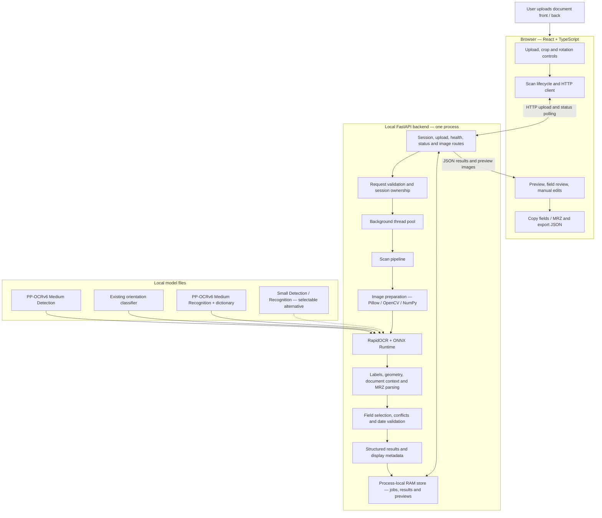
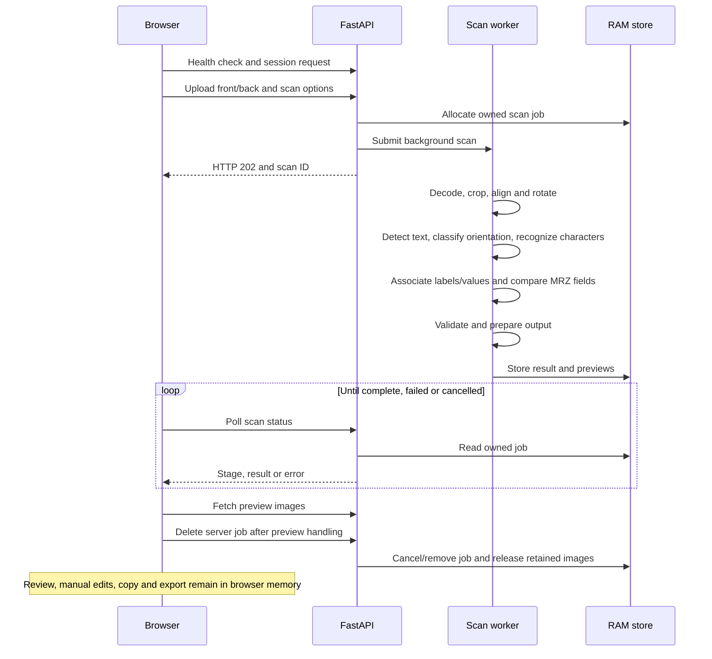

# DocuLens application architecture

Source inspection date: 3 November 2026. This document describes the existing `DOCULENS/doculens` application. It does not establish extraction accuracy or runtime readiness. No tests or OCR processing were run to generate it.

## System diagram

The backend is a modular monolith. Image preparation, OCR and extraction are modules inside the same Python application. Background workers are threads, not separate OCR servers. Document inference runs locally. There is no application database, cloud OCR dependency or external job queue in this flow.

## Scan sequence

Cancellation is cooperative. It prevents obsolete results from being retained but does not forcibly interrupt an ONNX call already executing. Deletion also occurs on applicable reset/cancellation paths. Expiry and backend shutdown provide additional cleanup.

## Source map

| Responsibility | Project path |
|---|---|
| Screen composition | `frontend/src/App.tsx` |
| Upload, crop, preview and results | `frontend/src/components/` |
| Scan lifecycle and cancellation | `frontend/src/hooks/useScan.ts` |
| Backend readiness and retries | `frontend/src/hooks/useBackendHealth.ts` |
| Scoped GSAP motion | `frontend/src/hooks/useMotion.ts` |
| HTTP client | `frontend/src/services/api.ts` |
| English field headings, dates and copying | `frontend/src/lib/format.ts` |
| Browser-side review edits | `frontend/src/lib/review.ts` |
| API routes and application lifecycle | `backend/app/main.py` |
| Settings, session ownership and request guards | `backend/app/core/` |
| Job and preview storage | `backend/app/core/store.py` |
| Typed request/result contracts | `backend/app/schemas/models.py` and `frontend/src/types/scan.ts` |
| Scan stages and orchestration | `backend/app/services/pipeline.py` |
| Decoding, PDF rendering and image geometry | `backend/app/services/imaging.py` |
| OCR engines, orientation and bounded regional rereads | `backend/app/services/ocr.py` |
| Medium export settings and compatibility validation | `backend/app/services/medium_models.py` |
| Caption fragments and label aliases | `backend/app/extractors/caption_context.py`, `label_matcher.py` |
| Spatial association and wrapped names | `backend/app/extractors/spatial_matcher.py` |
| Document and emergency-contact regions | `backend/app/extractors/document_context.py`, `regions.py` |
| MRZ parsing and check digits | `backend/app/extractors/mrz_parser.py` |
| Candidate selection and source conflicts | `backend/app/extractors/field_extractor.py` |
| Supported dates, countries and number patterns | `backend/app/patterns/` |
| Final normalization and output checks | `backend/app/services/output.py` |

## Configured local OCR models

Configuration is read from environment settings and `backend/.env` when the backend starts from its directory. The paths below are the local file configuration inspected for this document, not a live engine inspection.

| Stage | Configured file |
|---|---|
| Detection | `D:\DocuLens-OCR-Modelsmedium-det\inference (1).onnx` |
| Recognition | `D:\DocuLens-OCR-Modelsmedium\inference.onnx` |
| Orientation | `D:\DocuLens-OCR-Models\ch_ppocr_mobile_v2.0_cls_mobile.onnx` |
| Recognition dictionary | `D:\DocuLens-OCR-Models\ppocrv6_dict.txt` |
| Alternative detection | `D:\DocuLens-OCR-Models\PP-OCRv6_det_small.onnx` |
| Alternative recognition | `D:\DocuLens-OCR-Models\PP-OCRv6_rec_small.onnx` |

`DOCULENS_OCR_MODELS_DIR` supplies the base resources. `DOCULENS_OCR_MEDIUM_DET_PATH` and `DOCULENS_OCR_MEDIUM_REC_PATH` select the Medium stages. The loader reads same-stem YAML settings, checks dictionary mappings and validates ONNX signatures. Explicit invalid custom settings cause an error. Clearing both Medium overrides selects Small stages. Engines are reused within the backend; this is separate from retaining document results. An installed optional Arabic recognizer uses its own recognition configuration.

## Field and date flow

OCR observations contain text, confidence, bounding boxes, side and alternative readings. The extractor reconstructs supported captions, associates nearby values using geometry and context, then compares corresponding MRZ evidence. Printed fields have priority where reliably associated. MRZ provides fallback evidence for supported fields. No MRZ issue date is fabricated.

Results carry observed text, selected values, normalization metadata, validation states, source evidence and unresolved alternatives. Established full dates normalize to `YYYY-MM-DD` internally and display/copy as `DD-MMMM-YYYY`. A two-digit MRZ year alone cannot establish a century. Check digits validate aspects of transcription, not identity or authenticity.

## HTTP interface

| Method | Endpoint | Purpose |
|---|---|---|
| GET | `/api/v1/health` | Readiness and available OCR languages |
| POST | `/api/v1/session` | Issue local signed session cookie |
| POST | `/api/v1/scans` | Submit asynchronous scan |
| GET | `/api/v1/scans/{scan_id}` | Poll stage; the final reply carries the result and previews, then the scan is deleted |
| DELETE | `/api/v1/scans/{scan_id}` | Cancel/delete owned scan |
| POST | `/api/v1/extract` | One-shot adapter using the same worker pipeline |

The one-shot extraction adapter waits up to 120 seconds, returns its result without retained preview URLs, and deletes its job in cleanup.

## Runtime and data boundaries

- Development: browser → Vite at `127.0.0.1:5173` → `/api` proxy → FastAPI at `127.0.0.1:8000`.
- Built application: FastAPI can serve the existing `frontend/dist` and API from one origin. The Dockerfile provides separate frontend build and Python runtime stages.
- Default backend limits are 12 MB per uploaded side, eight active jobs, one job per session, deletion as soon as a result is delivered (60-second expiry for undelivered results), and 160 MiB for encoded previews awaiting delivery. The preview limit does not cover model sessions, decoded arrays or other working buffers.
- Uploaded document bytes, observations and results are processed in memory. User-generated exports and copied data are separately controlled by the user.
- Session ownership controls access to scans. The local signed cookie is not a full user-account authentication system.
- RAM storage and signing keys are process-local. Multiple independent backend processes would require shared state or a reviewed routing design. Increasing the thread pool does not eliminate the shared OCR lock.
- Linux deployment requires Linux-visible model paths and appropriate model mounts. Windows drive paths do not transfer automatically.

See [the detailed architecture reference](../ARCHITECTURE.md) for further explanation. This document was generated through source inspection only; it does not claim browser checks, OCR benchmarks or tests were performed.
