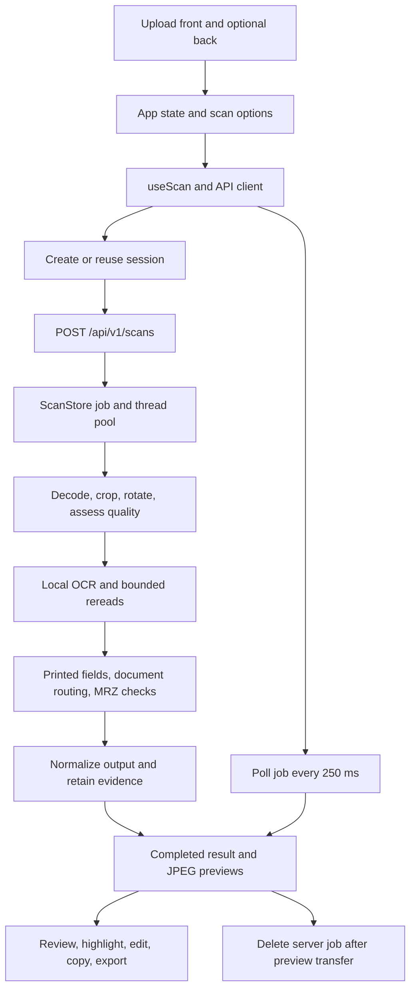

# DocuLens source study

Reviewed on 2 November 2026. This describes the working files in `DOCULENS/doculens`, including existing uncommitted changes. It is a learning reference, not a declaration that every feature is verified or every test passes. No application implementation was changed for this study.

## Scope and source of truth

The current project contains 29 Python files under `backend/app`, 16 backend test files, 29 frontend source/test/style files, and 7 support scripts. The study covered these project-owned files, startup/build configuration, dependency declarations, and project documentation. Third-party package internals, generated bundles, model weights, and every historical archive file were not reviewed line by line.

`../DocuLens-source/doculens` is a separate older copy. A content comparison found 5 new and 14 changed backend application files, 7 new and 8 changed backend test files, 8 new and 12 changed frontend source files, and 1 new and 2 changed scripts in the active tree. Editing one copy does not update the other or the ZIP.

For explanations, use current source and observed test results ahead of historical documentation. Several README/review statements no longer match the implementation.

## What the application does

DocuLens is a local browser application that reads passport and identity-document images. The browser sends files to a Python server on the same computer. The server prepares the image, runs pretrained local OCR models, associates recognized text with document fields, checks available MRZ data, and returns structured results with supporting evidence. The user reviews the source image, edits values if needed, and copies or exports results.

It uses a React/TypeScript interface and a FastAPI backend. Image preparation uses Pillow, OpenCV and NumPy; single-page PDFs use PDFium. RapidOCR coordinates ONNX models. Field extraction is application-written rules and geometry, not an LLM or a trained end-to-end identity-field model. There is no application database or model-training pipeline.

## Beginner learning order

1. Files, folders, source code, dependencies, and the difference between an application and its models.
2. The browser/frontend, Python/backend, HTTP requests, JSON responses, and local ports.
3. React components, props, state, hooks, and the user interface in `App.tsx`.
4. The upload-to-result journey through `api.ts`, `useScan.ts`, `main.py`, and `pipeline.py`.
5. Pixels, image dimensions, EXIF orientation, crop coordinates, and perspective correction.
6. OCR detection, orientation classification, recognition, dictionaries, and confidence.
7. Caption recognition, geometric association, field candidates, and retained evidence.
8. MRZ layouts, check digits, printed/MRZ comparisons, dates, and ambiguity.
9. Output formatting, manual edits, copy/export, and source highlighting.
10. Temporary storage, sessions, cancellation, memory, tests, startup, and deployment.

## Startup and deployment

`start.ps1` checks for the project's Python environment and an existing frontend build. It changes into `backend` and starts `uvicorn app.main:app` on `127.0.0.1:8000`. It does not build or install dependencies.

Importing `backend/app/main.py` creates `app` through `create_app()`. The factory constructs settings, the OCR service, scan storage, session signing, middleware, and routes. FastAPI's lifespan starts the scan thread pool, warms the Latin OCR engine with synthetic text, and starts periodic expiry cleanup. Shutdown cancels cleanup, clears stored results, and shuts down the executor.

An explicitly configured custom/Medium model failure stops startup; an unconfigured bundled-model warmup failure can instead leave a degraded service whose health response reports OCR unavailable.

Development uses Vite on port 5173 with `/api` proxied to port 8000. A production frontend build is mounted by FastAPI from `frontend/dist`, so no separate Node server is needed at runtime. The Dockerfile builds with Node and serves with Python under a non-root user. Its recipe was inspected, not built in this study. Machine-specific `D:` model paths need deployment-specific configuration.

## A scan from beginning to end



1. `UploadArea` checks MIME type and size in the browser. The backend independently checks bytes and limits; browser validation is not the security boundary.
2. `App` stores front/back `File` objects, crop/rotation options, Latin/Arabic choice, and numeric date order. Changing the front also clears the previous back. Input changes invalidate earlier results.
3. `useScan` aborts the previous operation, increments a generation counter, and starts a 180-second client deadline. The counter prevents older responses from replacing a newer scan.
4. `api.startScan` creates/reuses a session, then sends multipart front/back files and JSON options.
5. `main.scan` checks model readiness, option validity, language availability, file signatures, and size. It allocates a job and submits `run_scan` to a thread pool, returning HTTP 202.
6. `run_scan` processes each uploaded side, records actual processing stages and timings, combines OCR lines, extracts fields, normalizes output, and stores encoded previews and a typed result.
7. `useScan` polls status. On completion it displays the result immediately, then loads corrected previews. Raster originals reuse the uploaded file; PDFs need the rendered original from the server.
8. After preview requests settle, it attempts to delete the server job. Results and preview blobs stay in browser state. Failed deletion can be retried on reset/unmount; expiry is a fallback.
9. Clear, replacement, cancellation, and leaving the page reset state. Object URLs are revoked by `useObjectUrl`. Exported files and clipboard data have their own lifetimes.

Cancellation is cooperative. It prevents completed results from being restored, but it does not forcibly stop an ONNX call already executing.

## Backend module map

Paths below are relative to `backend/app`.

| File | Responsibility |
| --- | --- |
| `main.py` | Application factory, lifespan, HTTP routes, uploads, middleware wiring, production static frontend. |
| `core/config.py` | Pydantic settings from `DOCULENS_` environment variables and the current directory's `.env`. |
| `core/security.py` | Random HMAC-signed session cookies, expiry, and hashed ownership keys. |
| `core/middleware.py` | Body limits, unsafe-origin checks, optional HTTPS requirement, POST rate limiting, response privacy headers. |
| `core/store.py` | Locked in-memory jobs, capacity, expiry, cancellation, and encoded-image retention budget. |
| `schemas/models.py` | Request options, OCR observations, evidence, fields, MRZ, images, jobs, and health schemas. |
| `services/pipeline.py` | Runs the complete scan, updates stages, aggregates timings, and translates failures to safe job errors. |
| `services/imaging.py` | Decode/validate images and PDFs, EXIF normalization, bounded sizing, crop detection/warping, quality checks, regional OCR crops, JPEG encoding. |
| `services/ocr.py` | Loads and caches OCR engines, validates custom dictionaries, warms models, normalizes boxes/text, chooses orientation, recovers captions, and retries selected regions. |
| `services/medium_models.py` | Validates Medium ONNX paths and YAML metadata, maps preprocessing settings, checks graph input/output signatures. |
| `services/output.py` | Final name/date/ID/country presentation metadata, rectangular boxes, and aggregate source/check results. |
| `extractors/document_context.py` | Classifies observed headings per side; combines heading and MRZ evidence into a document type. |
| `extractors/label_matcher.py` | Recognizes supported captions, translations, bounded fuzzy caption matches, and explicit combined-row separators. |
| `extractors/caption_context.py` | Reconstructs split caption regions for association while retaining the original OCR fragments. |
| `extractors/spatial_matcher.py` | Measures candidates in the caption's baseline frame; rejects cross-side, obstructed, or competing associations; joins eligible wrapped names. |
| `extractors/regions.py` | Separates explicitly marked emergency-contact regions from holder biodata. |
| `extractors/field_extractor.py` | Coordinates printed extraction, candidate merging, MRZ fallback/cross-checking, names, document routing, number checks, and chronology. |
| `extractors/mrz_parser.py` | Detects adjacent MRZ rows, parses TD1/TD2/TD3 and partial passport evidence, checks structure/checksums, and applies constrained, documented substitutions. |
| `extractors/layout_fallback.py` | Narrow Indian-passport layout associations with multiple anchors; unsupported date/place roles remain unresolved evidence. |
| `patterns/common.py` | Supported main/additional captions, text folding, explicit country aliases, and cached public country reference data. |
| `patterns/dates.py` | Numeric/named multilingual date parsing, ambiguity, calendar checks, display formatting, and MRZ date comparison. |
| `patterns/passports.py` | Configured UK/US passport-number syntax checks. |
| `patterns/emirates_id.py` | The 15-digit `784` pattern and separator normalization; no authoritative ID checksum implementation. |

The `__init__.py` files establish Python packages; the extractors package also exposes its extraction entry point.

## Image and OCR details

Raster uploads support JPEG, PNG and WebP. A single PDF page is accepted per side and rendered locally, not read through a PDF text-extraction shortcut. Limits are 12 MiB per upload, 40 million input raster pixels, and a 12,000-pixel input edge. Raster inputs need at least 64 pixels in each dimension. Working images are bounded to 16 million pixels and a 6,000-pixel edge. These are allocation limits, not a total process-memory cap.

Automatic boundary detection uses a reduced image, Canny edges, morphology, threshold contours, a blue-paper fallback, and Hough lines. Candidate geometry is scored conservatively. Ambiguous boundaries preserve the complete image. Manual corners are normalized to the original EXIF-corrected image before rotation. OCR/evidence boxes use corrected-image pixel coordinates.

The OCR stages are text detection, line orientation classification, and character recognition. ONNX Runtime executes the models on CPU. The service uses a shared lock, so more scan threads do not automatically mean parallel OCR. Default native thread settings are two intra-op threads and one inter-op thread.

Weak full-image reads can try other right-angle orientations. The chosen reading is reused before regional recovery. Sparse passport captions may trigger one bounded enlarged biodata pass. At most six uncertain/important regions receive up to two recognition rereads. Original observations remain available; changed readings require corroboration or a narrowly constrained observed-date recovery and remain marked for review.

The local `backend/.env` selects Medium detection and Medium recognition from `D:` directories, with the Small bundle providing orientation/dictionary resources. Arabic replaces the recognizer and is loaded on demand; the service attempts to reuse detection/classification stages. Presence of the optional Arabic model does not establish its accuracy.

## Extraction rules that matter

- Printed extraction does not require MRZ. Headings establish document type independently of whether an ID number was read correctly.
- Recognizing a label and recognizing its value are separate operations. Fuzzy caption matching does not authorize altering an identity value.
- Candidate association uses position, text angle, distance, intervening rows, and competing captions. Confidence alone does not settle ownership.
- Readable associated print generally outranks MRZ in the current code. Conflicting printed candidates or equally supported readings can produce a null selected value with retained evidence.
- MRZ parses 2 x 44 (TD3), 2 x 36 (TD2), and 3 x 30 (TD1) layouts. Individual/composite check digits use the implemented 7/3/1 weighted arithmetic. Names have no check digit.
- Partial passport MRZ can expose independently delimited names/issuer and separately checked numeric-row fields, with uncertainty. It never pads missing characters to fabricate a full record.
- MRZ substitutions are bounded to four total changes and require the resulting structure/checks to pass. Mandatory numeric positions constrain lookalikes. A failed TD3 alphanumeric document number can also receive at most two lookalike changes when independently supported by a strong labeled printed number of the same length. Raw and interpreted lines remain separate.
- First name, given names, middle names, surname, and printed full name are separate semantics. A full name is not split by guessing. Printed-name assembly requires compatible, clear components in one column; MRZ-only assembly has its own explicit marker.
- Nationality, issuing country, and country code have separate sources. A card MRZ number can remain separate from a passport reference printed on the card.
- Dates preserve source text and separate normalized ISO values from display values. Established dates display/copy as `DD-MMMM-YYYY`. An ambiguous or incomplete date can retain the observed value without a normalized date. MRZ-only `YYMMDD` does not establish a century.
- Checked MRZ can resolve ambiguous printed day/month order using the printed full year. A narrowly constrained partial printed year can also support MRZ day/month fallback. Neither path infers a century from age or the current year.
- Chronology checks flag inconsistent dates without swapping their roles or rewriting years. Output normalization uppercases names and formats supported Emirates ID strings; raw/evidence data stays separate.

## Frontend module map

Paths below are relative to `frontend/src`.

| File | Responsibility |
| --- | --- |
| `main.tsx` | Mounts React in StrictMode and imports global CSS. |
| `App.tsx` | Main page, uploaded files/options, selected side, crop dialog, connectivity, scan controls, and result/preview wiring. |
| `components/UploadArea.tsx` | Browse/drop validation, file replacement/removal, front/back controls. |
| `components/DocumentViewer.tsx` | Original/corrected comparison, zoom/Fit, rotation/crop actions, PDF placeholder, evidence overlay. |
| `components/CropEditor.tsx` | Native dialog, pointer/keyboard corner movement, normalized coordinates. |
| `components/Progress.tsx` | Maps actual server stages to readable progress; no fabricated percentage. |
| `components/Results.tsx` | Field groups, review/edit controls, MRZ, diagnostics, copy, and JSON downloads. |
| `components/TechnicalDetails.tsx` | Raw OCR, observations, evidence, printed captions, validation and correction notes. |
| `components/ui/button.tsx` | Shared button variants using Radix Slot and class-variance-authority. |
| `hooks/useScan.ts` | Async scan lifecycle, polling, deadlines, stale-response protection, preview transfer, server deletion. |
| `hooks/useBackendHealth.ts` | Four bounded readiness attempts and manual reconnect, with cancellation and per-request deadlines. |
| `hooks/useObjectUrl.ts` | Creates and revokes browser blob URLs. |
| `hooks/useMotion.ts` | Lazy GSAP animations scoped to elements, reduced-motion support, cleanup. |
| `services/api.ts` | Same-origin fetch calls, multipart upload, HTTP error conversion, abort-aware delay. |
| `lib/format.ts` | English field headings, date display/copy, MRZ-source notes, chronology warnings. |
| `lib/review.ts` | Local edits, original extracted value preservation, edit markers, date validation, invalidation/recalculation of selected checks. |
| `lib/utils.ts` | Class merging and basic label formatting. |
| `types/scan.ts` | TypeScript representations of API payloads and client-only edit metadata. |
| `styles/index.css` | Tailwind import plus custom theme/layout, responsive comparison panel, typography, focus/touch controls, motion rules, review/highlight styling. |
| `test/` | Vitest/Testing Library cases, mocked API fixtures, jsdom setup. |

Manual edits stay in frontend state; there is no edit-save endpoint. Edited values have no OCR confidence and remain marked as user-entered/unverified. JSON exports include reviewed values, labels/display values, and original evidence. Printed assembled names remain in diagnostics/export; explicitly marked MRZ name assemblies are also shown in main results.

## API surface

All scan endpoints use the session's ownership key.

| Method | Route | Purpose |
| --- | --- | --- |
| GET | `/api/v1/health` | Public model readiness, supported language routes, limits and version. |
| POST | `/api/v1/session` | Create/reuse an HttpOnly, SameSite Strict session cookie. |
| POST | `/api/v1/scans` | Queue multipart front/back upload and options; HTTP 202. |
| GET | `/api/v1/scans/{id}` | Poll status/stage/result. |
| GET | `/api/v1/scans/{id}/image` | Fetch owned original/corrected JPEG for front/back. |
| DELETE | `/api/v1/scans/{id}` | Cancel/delete owned job. |
| POST | `/api/v1/extract` | One-shot multipart `file` adapter using the same worker; 120-second deadline, uppercase document type, no retained previews. |

OpenAPI JSON remains enabled; interactive Swagger/ReDoc pages are disabled. The current UI uses `/scans`, not `/extract`.

## State, privacy, and resource limits

`ScanStore` holds process-local jobs and encoded images behind an RLock. Defaults are eight total retained jobs, two per session, 900 seconds from job creation, and 160 MiB of retained encoded images. The storage budget excludes model sessions, decoded pixel arrays, temporary buffers, result objects, and browser memory. Queued/completed jobs both count toward capacity.

Session tokens last up to 24 hours and are signed by a randomly generated per-process key. Restarting loses both the key and jobs. Multiple independent Uvicorn processes would need shared state or another routing/session design; the current architecture assumes one process.

Middleware limits the total body to approximately two uploads plus multipart overhead and checks unsafe request origins. POST requests are limited to 30 per client address per minute with a bounded client map. It also supports HTTPS enforcement and no-store/nosniff/no-referrer/frame-denial response headers. These are local application controls, not an organizational login system.

## Memory evidence found during the study

These are saved benchmark artifacts, not new live measurements:

| Detector / recognizer | Saved peak process working set |
| --- | --- |
| Small / Small | 497.6 MiB |
| Small / Medium | 547.8 MiB |
| Medium / Small | 913.1 MiB |
| Medium / Medium | 966.3 MiB, about 0.94 GiB |

Sources: `ocr-medium-SS.json`, `ocr-medium-SM.json`, `ocr-medium-MS.json`, and `ocr-medium-MM.json` in this directory. The comparison script measures Windows peak working set after six fictional full-pipeline cases and additional tilted regressions. It excludes browser RAM and is neither an idle-memory measurement nor a workload-independent maximum. The configured Medium/Medium report is more relevant than `benchmark.json`'s older 165.84 MiB end-of-run RSS snapshot. Those two measurements use different workloads and metrics.

## Scripts and supporting files

| File | Role |
| --- | --- |
| `scripts/generate_fixture.py` | Renders an explicitly fictional passport fixture. |
| `scripts/benchmark.py` | Measures in-process API/OCR timings and an end-of-run RSS snapshot; currently hardcodes its report date to 2026-10-26. |
| `scripts/evaluate_accuracy.py` | Compares six expected fields across fictional image variants, preserving OCR observations. |
| `scripts/compare_ocr_models.py` | Compares selected Small/Medium stage combinations with synthetic region, character, field, MRZ, timing and memory metrics. |
| `scripts/smoke_http.py` | Exercises an already running HTTP server with a fictional fixture, ownership checks, image retrieval and deletion. |
| `scripts/download_arabic_model.py` | Downloads the optional model and checks a pinned SHA-256 before installation. |
| `scripts/package_project.py` | Packages source while excluding environments, caches, `.env`, model directories and generated builds. |
| `backend/pyproject.toml` | Python package and dependency declarations, pytest and Ruff settings. |
| `backend/requirements-lock.txt` | Historical dependency snapshot; does not include all later direct dependencies, including pycountry/RapidFuzz/PDFium. |
| `frontend/package.json` / lockfile | Frontend dependency declarations/resolutions and build/test/lint scripts. |
| `frontend/vite.config.ts` | React/Tailwind plugins, alias, API proxy and jsdom test configuration. |
| `frontend/tsconfig*.json` | Strict TypeScript compilation and project references. |
| `.env.example`, ignore files | Configuration examples and separation of source from local runtime material. |

## Checks executed for this study

Backend, from `backend`:

```powershell
../.venv/Scripts/python.exe -m pytest -q -m 'not integration' --tb=no -p no:cacheprovider --basetemp=../.cache/study-pytest-20261102
```

Result: **251 passed, 20 failed, 12 deselected**, with one Starlette/httpx deprecation warning. The failure groups concern unresolved dates, generic ID caption/context rules, unmatched headings, conflicting printed values, unknown colon captions, name assembly, layout fallback, and partial MRZ expectations.

Frontend, from `frontend`:

```powershell
npm.cmd test -- --reporter=dot
```

Result: **52 passed, 9 failed** across eight test files; failures are in `App.test.tsx` and `Results.test.tsx`. The initial sandbox run could not load Vite configuration; the approved rerun executed the tests. Observed outdated expectations include rejecting PDFs, slash-separated dates, older English heading capitalization, exact unaugmented JSON export, and copying conflicting values without annotations.

Some failures clearly demonstrate test/code contract drift. They are still failures, and the complete set has not been adjudicated as bugs versus obsolete requirements. No tests were changed to make this study pass. Real OCR integration/private-document tests, browser/device checks, new memory benchmarks, Docker, lint and production-build checks were not run in this study.

## Discrepancies to remember when explaining the project

1. Historical docs describe MRZ priority and confidence-based conflict selection differently from current `merge_field` behavior. Current print-first behavior is also explicitly asserted by newer field-selection tests.
2. The old API contract is incomplete: PDFs, `/extract`, later evidence metadata, and current frontend cleanup behavior need to be read from source.
3. Some older tests require unresolved dates to become null; current code can retain an unnormalized source reading with uncertainty.
4. Partial MRZ now exposes some readable fields, while older tests expect none.
5. Unknown colon-separated captions remain OCR transcript text; they are not automatically converted to identity fields.
6. The latest MRZ code includes printed-number-corroborated TD3 corrections in addition to numeric-position corrections; older descriptions omit this exception.
7. `MRZResult` repeats several field declarations in its class body. This is source duplication to clean up in a separate implementation task, not evidence of multiple serialized values.
8. Historical passing test counts and accuracy/performance reports are dated evidence, not the state of today's working tree.

For future explanations, separate what the code intends, what a particular test asserts, and what was actually observed in a runtime check.
